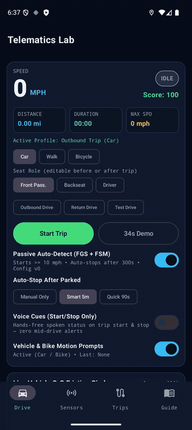
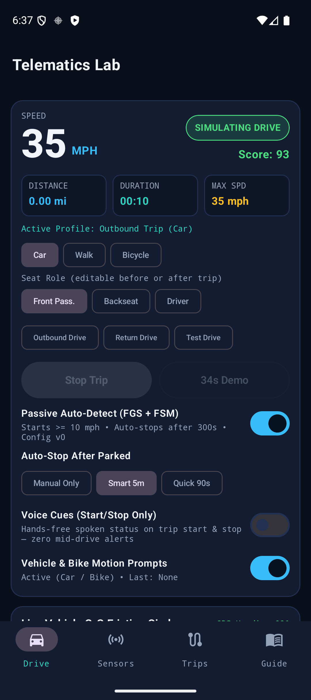
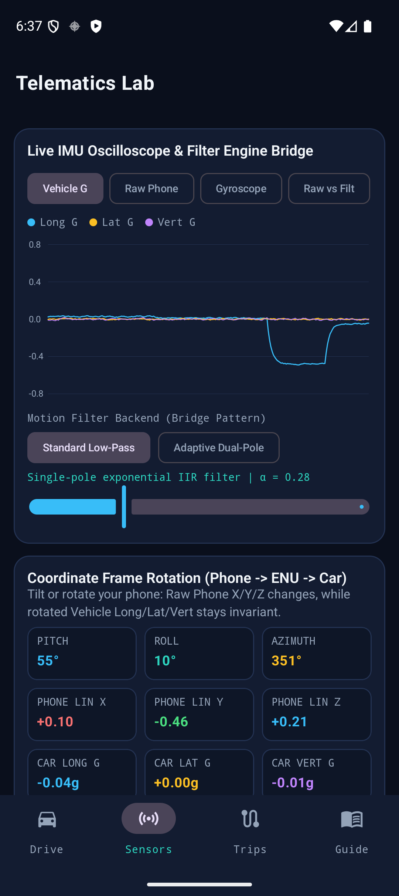
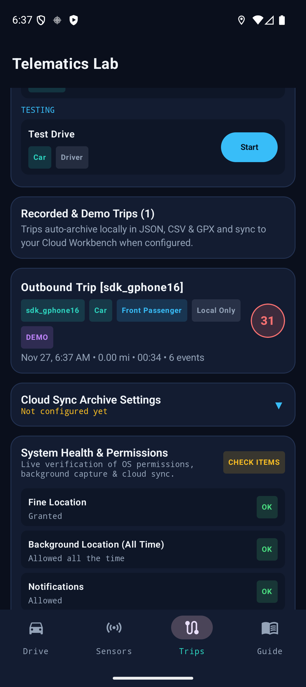
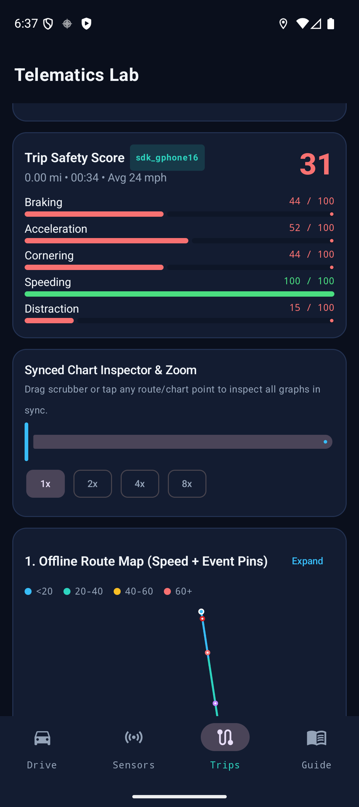
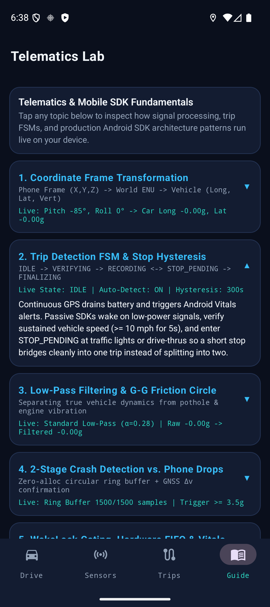

# Telematics SDK Lab & Interactive Workbench

An original, standalone Android smartphone telematics SDK, Jetpack Compose sensor lab application, and split-screen HTML5/Node interactive workbench built to validate mobile sensor fusion, trip detection, crash classification, and multi-platform telemetry sync end-to-end.

> **Companion iOS Repository:** Native SwiftUI + `CoreLocation` + `CoreMotion` + `MapKit` edition maintained in [phillipsk/telematics-sdk-ios](https://github.com/phillipsk/telematics-sdk-ios).

## Live Demo

Animated walkthrough captured on a clean Android emulator running the 34-second synthetic urban route (Live Drive & G-G Friction Circle → Sensors Lab Oscilloscope & 2-Stage Impact Classifier → Trips & Multi-Modal Presets → Offline Route Map & Synchronized Chart Zoom → Architecture Guide). **Click the animation to open the full HD MP4 (`android_demo.mp4`):**

<p align="center">
  <a href="docs/media/android_demo.mp4">
    
  </a>
</p>

## App Screenshots

<table>
  <tr>
    <td align="center"><strong>Live Drive &amp; HUD</strong></td>
    <td align="center"><strong>Sensors &amp; DSP Lab</strong></td>
    <td align="center"><strong>Trips &amp; Presets</strong></td>
    <td align="center"><strong>Route &amp; Chart Zoom</strong></td>
    <td align="center"><strong>Architecture Guide</strong></td>
  </tr>
  <tr>
    <td align="center"></td>
    <td align="center"></td>
    <td align="center"></td>
    <td align="center"></td>
    <td align="center"></td>
  </tr>
</table>

## Repository Layout

- **`android/`** — Standalone Android SDK + Jetpack Compose app (`com.telematicslab.demo`, minSdk 26 / targetSdk 35)
- **`workbench/`** — Zero-build split-screen Simulator, Live USB Streamer, and Cloud Replay Server (`server.mjs`, HTML5 Canvas, Node 22)
- **`docs/media/`** — Emulator-captured demo video (`android_demo.mp4`), inline GIF preview (`android_demo.gif`), and lossless screen captures

## Architecture & Software Design Patterns

The SDK (`android/app/src/main/kotlin/com/telematicslab/demo/sdk/`) separates pure domain signal processing from Android platform plumbing using standard production patterns:

- **Facade Pattern (`TelematicsSdk`)** — Exposes a concise public API and lifecycle entry point while keeping internal coroutine dispatchers, storage, and sensor pipelines isolated behind the boundary.
- **Bridge & Strategy Pattern (`SensorEngineBridge`, `MotionFilterEngine`)** — Decouples raw 50 Hz IMU ingestion from interchangeable DSP implementations (`StandardLowPassEngine` single-pole IIR vs. `AdaptiveTwoStageFilterEngine` cascaded noise attenuation).
- **Decorator Pattern (`WakeLockGatingEventSink`, `WakeLockStateController`)** — Wraps driving event delivery with remote-configurable, `Locale.ROOT`-normalized WakeLock state policies.
- **Finite State Machine (`TripStateMachine`)** — Explicit `IDLE → VERIFYING → RECORDING ↔ STOP_PENDING → FINALIZING → IDLE` transitions with >65 m GNSS accuracy filtering and configurable traffic-light stop hysteresis (`Manual Only`, `Quick 90s`, `Smart 5m`).
- **Zero-Allocation Circular Ring Buffer (`ImuRingBuffer`)** — Fixed primitive backing arrays (1,500 samples / 30s at 50 Hz) preventing GC pressure on hot sensor paths.
- **Observer / Unidirectional StateFlow (`StateFlow<TelematicsUiState>`)** — Drives Compose charts, synchronized timeline scrubbing, `1x–8x` timeline zoom, and full-screen modal inspection.
- **Host Fault Isolation & App Startup (`SdkSafeExecutor`, `androidx.startup`)** — Preserves structured concurrency `CancellationException` while trapping unexpected faults into telemetry, paired with modular `InitializationProvider` kickoffs, `ComponentCallbacks2` trim tracking, and API 30+ `ApplicationExitInfo` exit diagnostics.
- **2-Stage Impact & Phone-Drop Classifier (`DrivingEventDetector`)** — Combines peak G triggers from the ring buffer with gyroscope rotational tumble and pre/post GNSS speed change (Δv) to separate floor drops from collisions.
- **Bounded Offline Repository (`TripRepository`)** — 50 MB capacity cap with impact-preserving eviction, corrupt-file quarantine, Gzip idempotent chunking metadata, and JSON / CSV / GPX 1.1 export.

## Interactive Web Workbench (`workbench/`)

Open `workbench/index.html` locally for offline simulation & trip replay, or run `server.mjs` for USB live streaming and multi-device trip sync:

```bash
cd workbench
node --test tests/sim-engine.test.js tests/server.test.js
```

Stream live telemetry from an attached Android device over USB:

```bash
./workbench/launch-workbench.sh
```

For optional passcode-protected Cloud deployment with GCS persistence, configure `WORKBENCH_PASSCODE`, `WORKBENCH_SESSION_SECRET`, and `GCS_BUCKET` via environment variables at deploy time (never commit credentials).

## Quickstart & Testing (`android/`)

```bash
cd android
./gradlew :app:testDebugUnitTest :app:assembleDebug
adb install app/build/outputs/apk/debug/app-debug.apk
```
